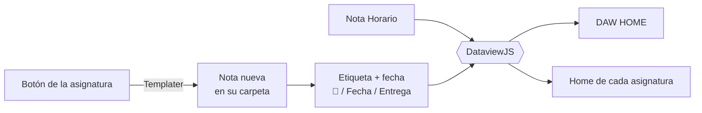

<div align="center">
  
</div>

<br>

<div align="center">
  <a href="https://git.io/typing-svg">
    
  </a>
</div>

<br>

<div align="center">
  
  
  
  
</div>

<br>

<div align="center">
  <a href="#-el-ecosistema">Ecosistema</a> ·
  <a href="#-qué-hay-en-este-repositorio">Contenido</a> ·
  <a href="#-estructura-de-la-bóveda">Estructura</a> ·
  <a href="#-daw-home-el-panel-de-control">Panel</a> ·
  <a href="#-complementos-activos">Complementos</a> ·
  <a href="#-cómo-funciona-por-dentro">Cómo funciona</a> ·
  <a href="#-cómo-usar-esta-bóveda">Cómo usarla</a> ·
  <a href="#-stack-del-curso">Stack del curso</a>
</div>

---

## 💎 El ecosistema

<table align="center" border="0" cellpadding="0" cellspacing="0" width="100%">
  <tr>
    <td width="35%" align="center" valign="middle">
      
    </td>
    <td width="65%" valign="middle">
      <ul>
        <li>🧠 <b>Enfoque:</b> notas conectadas entre sí para llegar a cualquier apunte rápidamente.</li>
        <li>⚙️ <b>Motores:</b> automatización dinámica y vistas de datos sobre mis propias notas.</li>
        <li>🌙 <b>Entorno:</b> optimizado sobre el <b>tema oscuro nativo</b>.</li>
        <li>📝 <b>Formato:</b> todo en Markdown plano, sin depender de ningún servicio.</li>
      </ul>
    </td>
  </tr>
</table>

> [!NOTE]
> Esta bóveda es mi segundo cerebro durante el Grado Superior en DAW: esquemas, fragmentos de código y documentación de cada módulo.

---

## 📦 Qué hay en este repositorio

| Elemento | Qué es | Para qué sirve |
|---|---|---|
| 🗜 **`Insti-backup.zip`** | La bóveda **completa**, plug and play: notas, adjuntos y la carpeta `.obsidian` con los 9 plugins, sus ajustes y los fragmentos CSS. | Descargar, descomprimir y abrir. Queda exactamente igual que en mi ordenador. |
| 📁 **`Insti/`** | Las mismas notas y capturas, sueltas. | Leer los apuntes directamente desde GitHub, sin descargar nada. |

> [!TIP]
> Cada vez que avanzo en el temario subo un `.zip` actualizado, así que el `.zip` es siempre la versión más reciente y completa de la bóveda.

---

## 🗂 Estructura de la bóveda

```text
Insti/                        ← la carpeta que se abre como bóveda
└── INSTITUTO/
    ├── DAW HOME              ← panel de control: clase actual, entregas, progreso, horario
    ├── Horario               ← tabla editable; el HOME la lee
    ├── Guía de uso           ← cómo añadir notas para que todo aparezca solo
    ├── Asignaturas/DAW1/
    │   └── <ASIGNATURA>/     ← una carpeta por módulo, todas iguales
    │       ├── <ASIGNATURA>.md   ← la «home» de la asignatura: botones + tablas automáticas
    │       ├── Temario/          teoría, bancos de preguntas, guías y esquemas
    │       ├── Actividades/      ejercicios hechos en clase
    │       ├── Evaluación/       exámenes y prácticas o proyectos evaluables
    │       └── Adjuntos/         imágenes y capturas de esa asignatura
    ├── Plantillas/           ← plantillas de Templater
    ├── database/             ← base de datos de notas
    └── DATABASE NOTAS DAW · DAW EXCEL   ← hojas para llevar las calificaciones
```

### 📚 Asignaturas de 1º de DAW

Cada asignatura tiene su propio color, que se repite en el panel, en el horario y en las tarjetas de tareas:

<div align="center">
  
  
  
  
  
  
  
  
</div>

<br>

| Carpeta | Módulo |
|---|---|
| 🗄 **BADAT** | Bases de Datos |
| ☕ **PROGRAMACIÓN** | Programación |
| 🖥 **SISTEMAS** | Sistemas Informáticos |
| 🧰 **ENTORNO** | Entornos de Desarrollo |
| 🏷 **LENGUAJE** | Lenguajes de Marcas y Sistemas de Gestión de Información |
| 💡 **DIGITALIZACIÓN** | Digitalización aplicada a los sectores productivos |
| 🌱 **SOSTENIBILIDAD** | Sostenibilidad aplicada al sistema productivo |
| 🧭 **IPE** | Itinerario Personal para la Empleabilidad |

---

## 🏠 DAW HOME: el panel de control

La nota `DAW HOME` es la página de inicio de la bóveda. Es un script de **DataviewJS** que recorre todas las notas, lee sus etiquetas y fechas, y pinta un panel que se actualiza solo:

| Tarjeta | Qué muestra |
|---|---|
| ⚡ **Accesos rápidos** | Botones (Meta Bind) para abrir el horario, buscar con Omnisearch, crear un Kanban o una nota desde plantilla. |
| 🎯 **Foco actual** | Un campo editable para apuntar en qué estoy centrado ahora mismo. |
| 🔢 **Contadores** | Días hasta el próximo examen, entregas de los próximos 7 días, tareas pendientes y tareas vencidas. |
| ⏱ **Ahora / Siguiente** | La clase que toca en este momento con una barra de tiempo restante, y la siguiente. Se refresca cada 30 segundos. |
| 📅 **Próximas semanas** | Lo vencido sin marcar, hoy, los próximos 7 días y las dos semanas siguientes; lo posterior aparece en «Más adelante». |
| 🕘 **Recientes** | Las últimas notas modificadas. |
| 📊 **Progreso por asignatura** | Tareas marcadas frente a tareas con etiqueta o fecha, por módulo. |
| 🗓 **Horario semanal** | La tabla de la nota `Horario`, coloreada por asignatura. |

Todo lo configurable (ventana de días, colores, alias de asignaturas, tipos de tarea) está agrupado en un bloque `CFG` al principio del script, así que se ajusta sin tocar el resto del código.



---

## 🔌 Complementos activos

Los nueve plugins que uso, agrupados por lo que hacen:

<table align="center" width="100%">
  <tr>
    <td width="50%" valign="top">
      <h3>🗂 Organización</h3>
      <ul>
        <li>📅 <b>Calendar</b> · vistas rápidas para notas diarias.</li>
        <li>📋 <b>Kanban</b> · tableros visuales para tareas en Markdown.</li>
        <li>⚙️ <b>Templater</b> · plantillas con sintaxis de programación para automatizar.</li>
      </ul>
      <h3>🔍 Búsqueda</h3>
      <ul>
        <li>🔍 <b>Omnisearch</b> · motor de búsqueda inteligente y ultrarrápido.</li>
      </ul>
    </td>
    <td width="50%" valign="top">
      <h3>🗄 Datos</h3>
      <ul>
        <li>🗄️ <b>Dataview</b> · consultas y vistas de datos complejas.</li>
        <li>🗃️ <b>Note Database</b> · bases de datos avanzadas (tablas, galerías...).</li>
        <li>📊 <b>Sheet Plus</b> · hojas de cálculo tipo Excel dentro de las notas.</li>
      </ul>
      <h3>📄 Documentos e interacción</h3>
      <ul>
        <li>📄 <b>PDF++</b> · gestión y anotación nativa de PDFs.</li>
        <li>🔘 <b>Meta Bind</b> · notas interactivas con botones y campos ocultos.</li>
      </ul>
    </td>
  </tr>
</table>

<details>
<summary><b>📋 Ver tabla resumen de plugins</b></summary>

<br>

| Plugin | Categoría | Qué aporta |
|---|---|---|
| 📅 Calendar | Organización | Calendario lateral para abrir y crear notas diarias |
| 📋 Kanban | Organización | Tableros de tareas guardados como Markdown |
| ⚙️ Templater | Organización | Plantillas dinámicas con lógica de programación |
| 🔍 Omnisearch | Búsqueda | Búsqueda rápida en notas, PDFs e imágenes |
| 🗄️ Dataview | Datos | Consultas tipo SQL sobre el contenido de la bóveda |
| 🗃️ Note Database | Datos | Vistas de tabla y galería sobre las notas |
| 📊 Sheet Plus | Datos | Hojas de cálculo incrustadas |
| 📄 PDF++ | Documentos | Anotar y enlazar PDFs sin salir de Obsidian |
| 🔘 Meta Bind | Interacción | Botones y campos que modifican las propiedades de la nota |

</details>

---

## ⚙️ Cómo funciona por dentro

<details open>
<summary><b>🏷 Etiquetas y propiedades</b></summary>

<br>

Regla de la bóveda: **la etiqueta dice qué tipo de nota es**; a qué asignatura y tema pertenece lo dicen las **propiedades** y la carpeta.

| Etiqueta | Qué es | Dónde vive |
|---|---|---|
| `asignatura` | La «home» de cada asignatura | raíz de la asignatura |
| `temario-home` | Índice de una unidad | `Temario/` |
| `temario` | Teoría, guías y bancos de preguntas | `Temario/` |
| `actividades-home` | Índice de actividades de una unidad | `Actividades/` |
| `actividad` | Ejercicio hecho en clase | `Actividades/` |
| `practica` | Práctica o proyecto evaluable | `Evaluación/` |
| `examen` | Examen | `Evaluación/` |
| `Tasks`, `Calendario` | Notas de día creadas desde el calendario | `Tasks/` |

</details>

<details>
<summary><b>➕ Tres formas de apuntar una entrega para que salga en el panel</b></summary>

<br>

1. **Con los botones de la asignatura:** 📖 Nueva Teoría, 📝 Nueva Actividad, 💻 Crear Nueva Práctica y 🚨 Registrar Examen. Templater crea la nota en la carpeta correcta y detecta la asignatura sola.
2. **Con una tarea suelta en cualquier nota:**

   ```markdown
   - [ ] #practica Entregar práctica de grafos 📅 2026-10-15
   - [ ] #examen Examen Tema 2 📅 2026-10-20
   ```

3. **Desde el calendario:** al pulsar un día se crea su nota con plantilla y lo que escribas dentro hereda esa fecha.

La fecha se busca en este orden: el `📅` de la tarea → las propiedades `Fecha` / `Entrega` de la nota → la fecha del nombre de la nota.

</details>

<details>
<summary><b>🧩 Plantillas incluidas</b></summary>

<br>

| Plantilla | Para qué |
|---|---|
| Plantilla Teoría | Apuntes de un tema |
| Plantilla Actividad | Ejercicios de clase |
| Plantilla Práctica | Prácticas y proyectos con fecha de entrega |
| Plantilla Examen | Exámenes con su fecha |
| Plantilla Dia | Notas diarias del calendario |
| Plantilla DAW 1 | La «home» de una asignatura nueva, con sus botones |
| Plantilla | Plantilla base genérica |

</details>

<details>
<summary><b>🎨 Apariencia</b></summary>

<br>

Sobre el tema oscuro nativo, la bóveda activa sus propios fragmentos CSS (incluidos en el `.zip`):

`callout` · `titulos` · `titulo-banner` · `formato-texto` · `completito` · `nativos-extra` · `ui-componentes` · `ui-tipografia`

</details>

---

## 🚀 Cómo usar esta bóveda

### Opción A · Plug and play con el `.zip` (recomendada)

1. Descarga **[`Insti-backup.zip`](https://github.com/kiravsl2018/Obsidian-GitHub/raw/main/Insti-backup.zip)** y descomprímelo.
2. En Obsidian, elige **Abrir carpeta como bóveda** y selecciona la carpeta **`Insti`** (la que contiene `INSTITUTO`, no `INSTITUTO` en sí: los botones y plantillas usan rutas que empiezan por `INSTITUTO/`).
3. Cuando Obsidian lo pregunte, pulsa **Confiar en el autor y activar complementos**. Los nueve plugins, sus ajustes y los estilos ya vienen dentro.
4. Abre la nota **`DAW HOME`**.

### Opción B · Desde la carpeta del repositorio

> [!NOTE]
> La carpeta `Insti/` del repositorio no incluye la configuración `.obsidian`, así que los plugins y los estilos hay que instalarlos a mano.

1. **Clona o descarga** este repositorio.
2. En Obsidian, elige **Abrir carpeta como bóveda** y selecciona la carpeta.
3. Activa los **complementos de la comunidad** y comprueba que los nueve plugins de arriba están habilitados.
4. Si falta alguno, instálalo desde el explorador de complementos de la comunidad.

> [!TIP]
> Si usas otro tema, cambia al **tema oscuro nativo** para ver las notas tal y como yo las veo.

---

## 💻 Stack del curso

<div align="center">
  
  
  
  
  
  
</div>

<br>

| Tecnología | Lo que practico con ella |
|---|---|
| ☕ **Java** | Programación orientada a objetos y lógica de aplicaciones |
| 🌐 **HTML5 y CSS3** | Estructura y diseño de páginas web |
| ⚡ **JavaScript** | Interactividad y lógica en el navegador |
| 🗃 **MySQL** | Diseño de bases de datos y consultas SQL |
| 📝 **Markdown** | Documentación de todo lo anterior |

---

<div align="center">
  <sub>💜 Hecho con Obsidian · Todo lo que aprendo, conectado</sub>
</div>

<div align="center">
  
</div>
